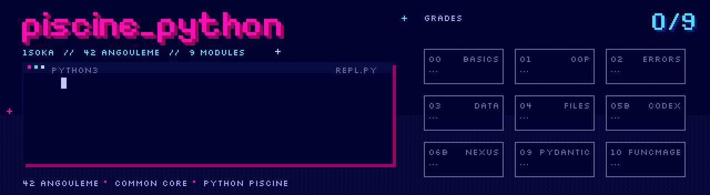
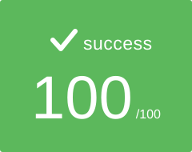

*This project has been created as part of the 42 curriculum by 1soka.*

<p align="center"></p>

<div align="center">

# 🐍 piscine_python — 42 Angoulême


<br>


</div>

## 📖 Description

**piscine_python** is the Python Piscine of the 42 common core: a series of modules that take Python from the very basics to object-oriented design, packaging, data validation and functional programming.

Each module is a set of small exercises with strict rules: the code must pass **flake8**, be fully **type-hinted** and checked with **mypy**, and only use the functions the subject allows. This repository contains the **9 modules** I validated, all graded **100/100** through peer evaluations.

---

## 📝 Result

<div align="center">
<table>
  <tr>
    <th>Module 00</th>
    <th>Module 01</th>
    <th>Module 02</th>
  </tr>
  <tr>
    <td align="center"></td>
    <td align="center"></td>
    <td align="center"></td>
  </tr>
  <tr>
    <th>Module 03</th>
    <th>Module 04</th>
    <th>Module 05 bis</th>
  </tr>
  <tr>
    <td align="center"></td>
    <td align="center"></td>
    <td align="center"></td>
  </tr>
  <tr>
    <th>Module 06 bis</th>
    <th>Module 09</th>
    <th>Module 10</th>
  </tr>
  <tr>
    <td align="center"></td>
    <td align="center"></td>
    <td align="center"></td>
  </tr>
</table>
</div>

---

## 🧩 Modules

| Module | Name | Key concepts |
|:---:|---|---|
| `00` | Basics | Input / output, conditions, loops, functions, recursion, type hints |
| `01` | Code Cultivation | Classes, objects, encapsulation, inheritance, `@property`, class and static methods |
| `02` | Garden Guardian | Exceptions, custom exceptions, `raise`, `try` / `except` / `finally` |
| `03` | Collections | `sys.argv`, lists, tuples, sets, dictionaries, generators |
| `04` | Files & Streams | `open` and `with`, stdin / stdout / stderr, context managers, safe cleanup |
| `05 bis` | The Codex | `venv`, `pip`, Poetry, `.env` variables, packages, `__init__.py`, imports |
| `06 bis` | Code Nexus | Abstract classes, polymorphism, `Protocol`, multiple inheritance, factories, strategies |
| `09` | Cosmic Data | Pydantic models, field constraints, enums, model validation |
| `10` | FuncMage | Lambdas, higher-order functions, closures, `functools`, decorators |

---

## ⚙️ Instructions

Requirements: **Python 3.10+**, `flake8` and `mypy`.

```bash
git clone https://github.com/1soka/Piscine_python.git
cd Piscine_python
python3 python_module_00/ex0/<script>.py    # every exercise is a standalone script
```

Modules that need external packages run inside a virtual environment, never committed:

```bash
python3 -m venv .venv
source .venv/bin/activate
pip install pydantic flake8 mypy            # module 09
deactivate
```

Check a module the same way it was evaluated:

```bash
flake8 python_module_09 --exclude .venv
python3 -m mypy python_module_09
```

---

## 📏 Rules followed

| Rule | How it is checked |
|---|---|
| PEP 8 style | `flake8` returns no error |
| Type hints on every function and method | `mypy` returns no error |
| Only the authorized functions | Compared with the list given in each subject |
| No code running on import | Every script ends with `if __name__ == "__main__":` |
| No crash on bad input | Errors are caught and reported, never left as a traceback |

---

## 📚 Resources

- [The Python Tutorial](https://docs.python.org/3/tutorial/): the official starting point for the basics.
- [PEP 8](https://peps.python.org/pep-0008/): the style guide that `flake8` enforces.
- [typing](https://docs.python.org/3/library/typing.html) and [mypy](https://mypy.readthedocs.io/): type hints and static checking.
- [abc](https://docs.python.org/3/library/abc.html): abstract base classes, the heart of Code Nexus.
- [venv](https://docs.python.org/3/library/venv.html) and [Poetry](https://python-poetry.org/docs/): isolated environments and dependency management.
- [Pydantic](https://docs.pydantic.dev/latest/): data models and validation for Cosmic Data.
- [functools](https://docs.python.org/3/library/functools.html): higher-order functions and decorators for FuncMage.

### How AI was used

AI was used to **explain concepts** (abstract classes, closures, decorators, Pydantic validation), to **build local test scripts** that check flake8, mypy and the expected outputs, and to **review the wording** of this README. Every exercise was understood, tested and **defended during peer evaluations**, and the subjects always had the final word.

---

## 🗂️ Repository structure

```
Piscine_python/
├── python_module_00/   # Basics
├── python_module_01/   # Code Cultivation
├── python_module_02/   # Garden Guardian
├── python_module_03/   # Collections
├── python_module_04/   # Files & Streams
├── python_module_05/   # 05 bis: The Codex
├── python_module_06/   # 06 bis: Code Nexus
├── python_module_09/   # Cosmic Data
├── python_module_10/   # FuncMage
└── assets/             # Banner + grade badge used in this README
```

Each folder holds the exercises of one module, laid out exactly as its subject asks.

---

## 🏆 Final words

A big thank you to everyone at 42 Angoulême who evaluated these modules, asked the tricky questions about closures and abstract classes, and pushed me to understand every single line. Going from `print()` to decorators, abstract factories and Pydantic models was intense, and I really enjoyed it. 💗

<div align="center">

**Made with ☕, 💗 and a lot of tracebacks by [1soka](https://github.com/1soka)**

</div>
